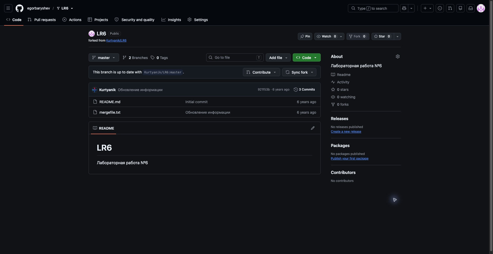
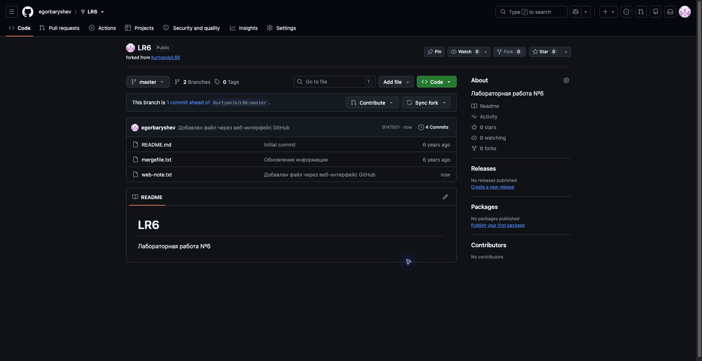
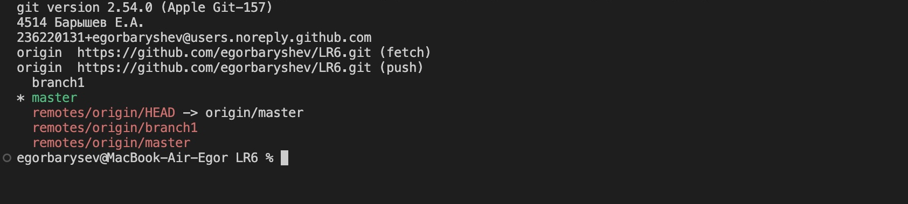
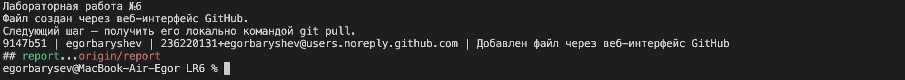
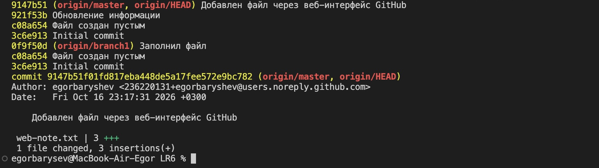
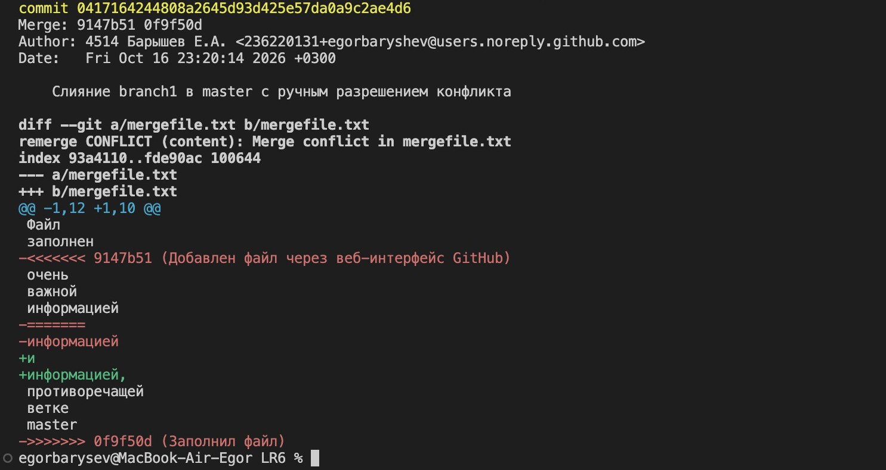
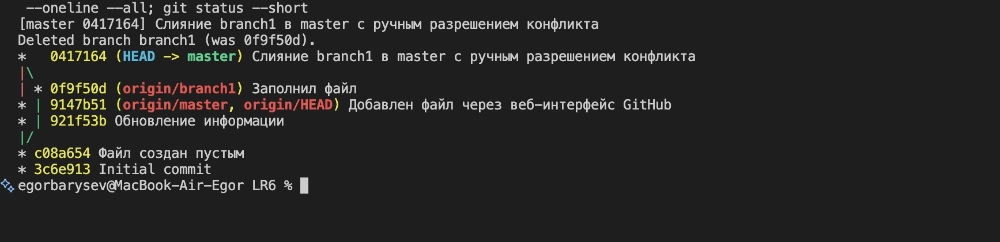
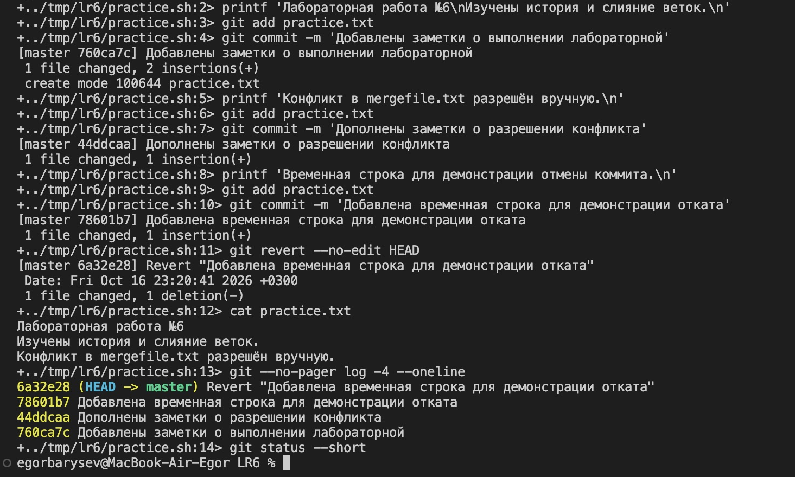
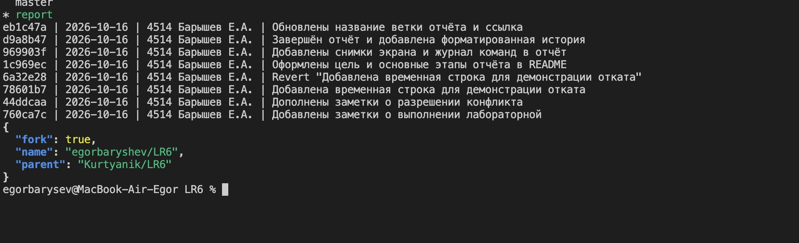
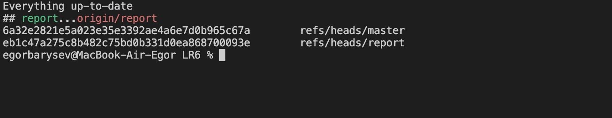

# Лабораторная работа №6
## Система контроля версий

Выполнил: студент группы 4514 Барышев Е.А.  
Дата выполнения: 16 октября 2026 года.

## Цель работы

Изучить базовые возможности Git и выполнить операции с локальным и удалённым репозиторием: просмотр истории, слияние веток, разрешение конфликта, создание и отмену коммитов.

## Подготовка

Создан fork [Kurtyanik/LR6](https://github.com/Kurtyanik/LR6) с ветками `master` и `branch1` в личном репозитории [egorbaryshev/LR6](https://github.com/egorbaryshev/LR6). На компьютере уже установлен Git 2.54.0 (Apple Git-157). Для репозитория настроены имя `4514 Барышев Е.А.` и адрес GitHub noreply.

После клонирования через веб-интерфейс GitHub добавлен файл `web-note.txt`. Командой `git pull --ff-only origin master` файл получен в локальной копии.

## История и слияние

Просмотрена история обеих веток и последние изменения. Ветки изменяли один участок файла `mergefile.txt`, поэтому команда `git merge branch1` привела к конфликту. При ручном редактировании сохранён текст обеих версий, удалены маркеры конфликта. После `git add mergefile.txt` создан merge-коммит `0417164`. Локальная ветка `branch1` удалена командой `git branch -d branch1`.

## Фиксация изменений и откат

В файл `practice.txt` последовательно добавлены заметки и временная строка. Созданы три коммита: `760ca7c`, `44ddcaa`, `78601b7`. Последний отменён командой `git revert --no-edit HEAD`. Коммит отмены `6a32e28` удалил временную строку, сохранив историю. Команда `git diff HEAD~2 HEAD -- practice.txt` после отмены не показала различий.

## Ветка отчёта

Для отчёта создана отдельная ветка `report`. Отчёт оформляется в Markdown; снимки экрана размещаются в папке `screenshots`.

## Проверка через GitHub API

Команда `gh api repos/egorbaryshev/LR6` вернула `fork: true`, имя `egorbaryshev/LR6` и родительский репозиторий `Kurtyanik/LR6`. Это подтверждает создание личного fork.

## Снимки экрана

### Рисунок 1

Личный fork с двумя ветками.



### Рисунок 2

Файл web-note.txt добавлен через сайт.



### Рисунок 3

Версия Git и локальные настройки автора.



### Рисунок 4

Проверка полученного веб-файла.



### Рисунок 5

История обеих веток и последний веб-коммит.



### Рисунок 6

Конфликт и ручное разрешение в выводе git show --remerge-diff.



### Рисунок 7

Merge-коммит и удаление локальной branch1.



### Рисунок 8

Три коммита и отмена последнего через git revert.



### Рисунок 9

Ветка отчёта, форматированная история и GitHub API.



### Рисунок 10

Проверка отправки master и report на GitHub.



## Лог команд

Команды приведены без результатов выполнения. Файлы mergefile.txt и README.md редактировались отдельно от Git-команд.

```sh
git --version
git clone https://github.com/egorbaryshev/LR6.git LR6
cd LR6
git config user.name '4514 Барышев Е.А.'
git config user.email '236220131+egorbaryshev@users.noreply.github.com'
git config core.quotePath false
git config --get user.name
git config --get user.email
git remote -v
git branch -a
git pull --ff-only origin master
cat web-note.txt
git branch --track branch1 origin/branch1
git log master --oneline
git log branch1 --oneline
git show master --stat
git diff master...branch1 -- mergefile.txt
git merge branch1
git status --short
cat mergefile.txt
git add mergefile.txt
git commit -m 'Слияние branch1 в master с ручным разрешением конфликта'
git branch -d branch1
git log --graph --oneline --all
printf 'Лабораторная работа №6\nИзучены история и слияние веток.\n' > practice.txt
git add practice.txt
git commit -m 'Добавлены заметки о выполнении лабораторной'
printf 'Конфликт в mergefile.txt разрешён вручную.\n' >> practice.txt
git add practice.txt
git commit -m 'Дополнены заметки о разрешении конфликта'
printf 'Временная строка для демонстрации отмены коммита.\n' >> practice.txt
git add practice.txt
git commit -m 'Добавлена временная строка для демонстрации отката'
git revert --no-edit HEAD
cat practice.txt
git log -4 --oneline
git diff HEAD~2 HEAD -- practice.txt
git switch -c report
git add README.md
git commit -m 'Оформлены цель и основные этапы отчёта в README'
git show --remerge-diff 0417164 -- mergefile.txt
gh api repos/egorbaryshev/LR6 --jq '{name: .full_name, fork: .fork, parent: .parent.full_name, default_branch: .default_branch}'
git add README.md commands.log screenshots
git commit -m 'Добавлены снимки экрана и журнал команд в отчёт'
git push -u origin master report
git push origin --delete branch1
git status -sb
git ls-remote --heads origin
git log --all --format='%h | %ad | %an | %s' --date=short
git add README.md commands.log history.txt screenshots/10-push.png
git commit -m 'Завершён отчёт и добавлена форматированная история'
git push origin report
```

## Форматированная история

История перед финальной фиксацией отчёта. Формат строки: сокращённый хэш, дата, имя автора, комментарий. Последующий финальный коммит доступен в истории репозитория.

```text
969903f | 2026-10-16 | 4514 Барышев Е.А. | Добавлены снимки экрана и журнал команд в отчёт
1c969ec | 2026-10-16 | 4514 Барышев Е.А. | Оформлены цель и основные этапы отчёта в README
6a32e28 | 2026-10-16 | 4514 Барышев Е.А. | Revert "Добавлена временная строка для демонстрации отката"
78601b7 | 2026-10-16 | 4514 Барышев Е.А. | Добавлена временная строка для демонстрации отката
44ddcaa | 2026-10-16 | 4514 Барышев Е.А. | Дополнены заметки о разрешении конфликта
760ca7c | 2026-10-16 | 4514 Барышев Е.А. | Добавлены заметки о выполнении лабораторной
0417164 | 2026-10-16 | 4514 Барышев Е.А. | Слияние branch1 в master с ручным разрешением конфликта
9147b51 | 2026-10-16 | egorbaryshev | Добавлен файл через веб-интерфейс GitHub
921f53b | 2020-11-21 | Kurtyanik | Обновление информации
0f9f50d | 2020-11-21 | Kurtyanik | Заполнил файл
c08a654 | 2020-11-21 | Kurtyanik | Файл создан пустым
3c6e913 | 2020-11-21 | Kurtyanik | Initial commit
```

## Результат

Ветка master содержит выполненные операции слияния и отмены коммита. Ветка report содержит отчёт, журнал команд, историю и папку снимков экрана. Обе ветки отправлены на GitHub. После слияния branch1 удалена локально и на сервере.

Ссылка на отчёт: https://github.com/egorbaryshev/LR6/tree/report

## Вывод

В работе освоены клонирование репозитория, получение изменений с сервера, просмотр истории и сравнение версий. Выполнено слияние с ручным разрешением конфликта. На примере git revert проверена отмена изменения с сохранением истории. Отчёт оформлен в Markdown и опубликован в отдельной ветке.
