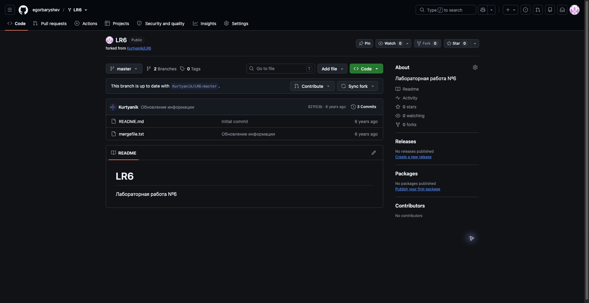
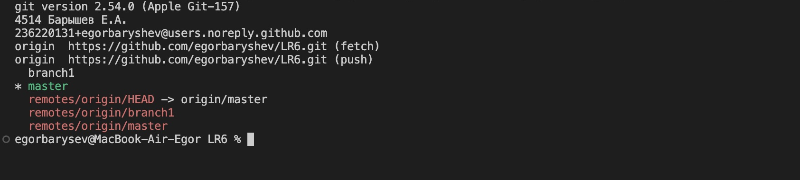
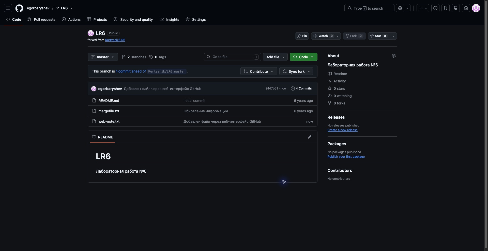
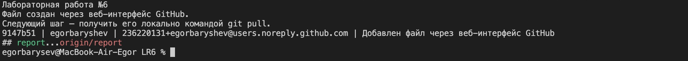
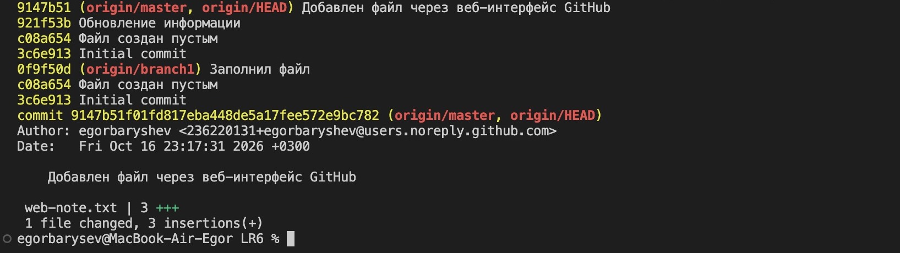
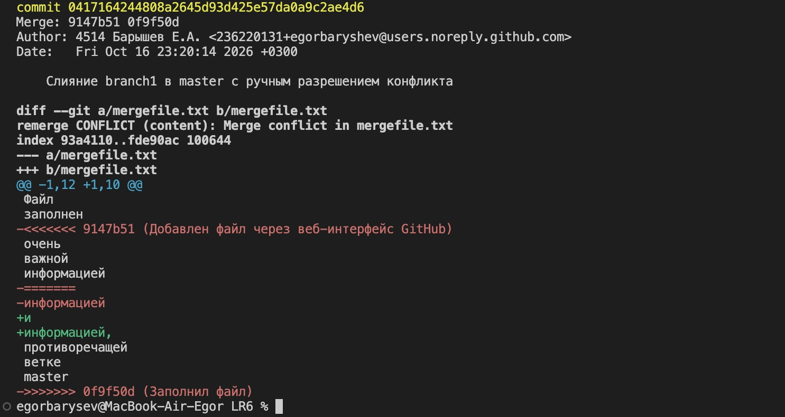
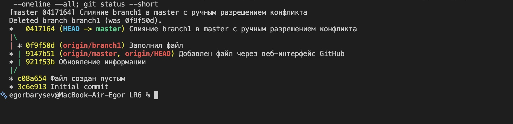
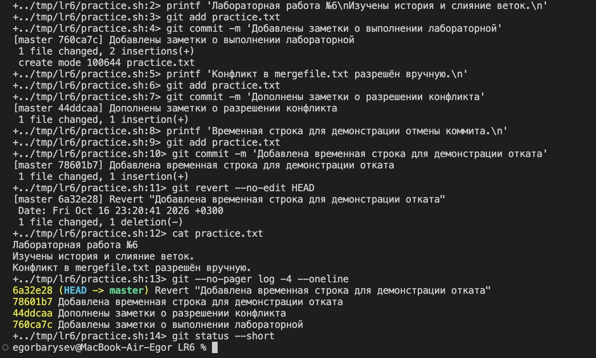
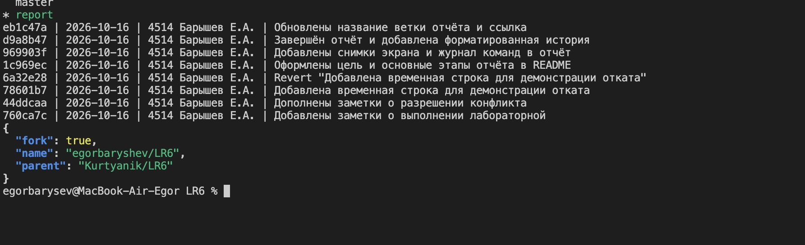
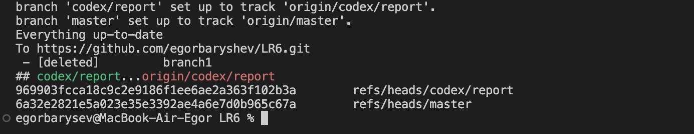

# Лабораторная работа №6

## Система контроля версий

Выполнил: студент группы 4514 Барышев Е.А.

## 1. Цель лабораторной работы

Изучить базовые возможности системы контроля версий Git, получить опыт работы с локальным и удалённым репозиторием, выполнить запрос к GitHub API.

## 2. Задание

Создать личный fork репозитория LR6, клонировать его, получить изменения с GitHub, изучить историю веток и выполнить слияние с разрешением конфликта. Создать несколько коммитов, отменить один из них и оформить отчёт в отдельной ветке.

## 3. Подготовка репозитория

На GitHub создан fork Kurtyanik/LR6 с ветками master и branch1 (рис. 1). На компьютере уже установлен Git 2.54.0. Репозиторий клонирован командой git clone. В локальных настройках указаны имя «4514 Барышев Е.А.» и адрес GitHub noreply (рис. 2).



<p align="center">Рисунок 1 - Личная копия репозитория с двумя ветками</p>



<p align="center">Рисунок 2 - Версия Git и настройки локального репозитория</p>

## 4. Получение изменений с GitHub

После клонирования через веб-интерфейс GitHub создан файл web-note.txt. Изменение зафиксировано коммитом 9147b51 с комментарием «Добавлен файл через веб-интерфейс GitHub» (рис. 3).



<p align="center">Рисунок 3 - Файл web-note.txt в удалённом репозитории</p>

Для получения файла в локальную копию выполнена команда git pull --ff-only origin master. Файл появился в рабочем каталоге. Затем проверены его содержимое и автор веб-коммита (рис. 4). Для локальных и веб-коммитов используется адрес noreply.



<p align="center">Рисунок 4 - Проверка содержимого файла и веб-коммита</p>

## 5. История веток и конфликт слияния

Командами git log просмотрена история master и branch1. До добавления файла через сайт вершиной master был 921f53b, после получения изменений - 9147b51. Вершина branch1 - 0f9f50d. Общий предок веток - c08a654. Командой git show просмотрены последние изменения (рис. 5).



<p align="center">Рисунок 5 - История обеих веток и сведения о последнем коммите</p>

Команда git merge branch1 вызвала конфликт в mergefile.txt: обе ветки изменили один участок файла. Текст отредактирован вручную, сохранены фрагменты обеих версий и удалены маркеры конфликта. На рисунке 6 показано разрешение конфликта из merge-коммита командой git show --remerge-diff.



<p align="center">Рисунок 6 - Конфликт и его разрешение в merge-коммите</p>

## 6. Фиксация слияния и отмена коммита

После git add mergefile.txt создан merge-коммит 0417164. Локальная ветка branch1 удалена командой git branch -d branch1 (рис. 7). После отправки результата на сервер удалена и удалённая ветка branch1.



<p align="center">Рисунок 7 - Результат слияния и удаление локальной ветки</p>

В practice.txt последовательно добавлены заметки и временная строка. Созданы коммиты 760ca7c, 44ddcaa и 78601b7. Последний отменён командой git revert --no-edit HEAD. Коммит 6a32e28 удалил временную строку, сохранив историю (рис. 8). Сравнение git diff HEAD~2 HEAD -- practice.txt не показало различий.



<p align="center">Рисунок 8 - Создание коммитов и отмена временного изменения</p>

## 7. Оформление отчёта и синхронизация

Командой git switch -c report создана ветка отчёта. В README.md записаны цель, ход выполнения и вывод. Снимки экрана помещены в папку screenshots. При оформлении созданы отдельные коммиты для основного текста, снимков и журнала команд, затем для форматированной истории.

Для истории использован формат «сокращённый хэш | дата | имя автора | комментарий». Через GitHub API получены имя репозитория, признак fork и родительский репозиторий Kurtyanik/LR6 (рис. 9).



<p align="center">Рисунок 9 - Ветка отчёта, форматированная история и GitHub API</p>

Ветки master и report отправлены на GitHub командой git push. Команда git ls-remote --heads origin подтвердила наличие веток на сервере. Объединённая branch1 удалена на сервере командой git push origin --delete branch1 (рис. 10).



<p align="center">Рисунок 10 - Проверка синхронизации с GitHub</p>

Отчёт в репозитории: https://github.com/egorbaryshev/LR6/tree/report

## 8. Лог команд

Ниже приведены команды без результатов выполнения. Редактирование mergefile.txt и README.md выполнялось отдельно от Git-команд.

```text
git --version
git clone https://github.com/egorbaryshev/LR6.git LR6
cd LR6
git config user.name '4514 Барышев Е.А.'
git config user.email '236220131+egorbaryshev@users.noreply.github.com'
git config core.quotePath false
git config --get user.name
git config --get user.email
git remote -v
git branch -a
git pull --ff-only origin master
cat web-note.txt
git branch --track branch1 origin/branch1
git log master --oneline
git log branch1 --oneline
git show master --stat
git diff master...branch1 -- mergefile.txt
git merge branch1
git status --short
cat mergefile.txt
git add mergefile.txt
git commit -m 'Слияние branch1 в master с ручным разрешением конфликта'
git branch -d branch1
git log --graph --oneline --all
printf 'Лабораторная работа №6\nИзучены история и слияние веток.\n' > practice.txt
git add practice.txt
git commit -m 'Добавлены заметки о выполнении лабораторной'
printf 'Конфликт в mergefile.txt разрешён вручную.\n' >> practice.txt
git add practice.txt
git commit -m 'Дополнены заметки о разрешении конфликта'
printf 'Временная строка для демонстрации отмены коммита.\n' >> practice.txt
git add practice.txt
git commit -m 'Добавлена временная строка для демонстрации отката'
git revert --no-edit HEAD
cat practice.txt
git log -4 --oneline
git diff HEAD~2 HEAD -- practice.txt
git switch -c report
git add README.md
git commit -m 'Оформлены цель и основные этапы отчёта в README'
git show --remerge-diff 0417164 -- mergefile.txt
gh api repos/egorbaryshev/LR6 --jq '{name: .full_name, fork: .fork, parent: .parent.full_name, default_branch: .default_branch}'
git add README.md commands.log screenshots
git commit -m 'Добавлены снимки экрана и журнал команд в отчёт'
git push -u origin master report
git push origin --delete branch1
git status -sb
git ls-remote --heads origin
git log --all --format='%h | %ad | %an | %s' --date=short
git add README.md commands.log history.txt screenshots/10-push.png
git commit -m 'Завершён отчёт и добавлена форматированная история'
git push origin report
git log --all --format='%h | %ad | %an | %s' --date=short
git add README.md commands.log history.txt
git commit -m 'Уточнён итоговый отчёт и обновлён снимок истории'
git push origin report
```

## 9. Форматированная история

Ниже приведён снимок истории перед заключительной корректировкой отчёта. Формат: сокращённый хэш, дата, имя автора, комментарий. Коммит заключительной корректировки появится в истории репозитория после сохранения этого снимка.

```text
554701f | 2026-10-16 | 4514 Барышев Е.А. | Обновлены снимки проверки ветки report
eb1c47a | 2026-10-16 | 4514 Барышев Е.А. | Обновлены название ветки отчёта и ссылка
d9a8b47 | 2026-10-16 | 4514 Барышев Е.А. | Завершён отчёт и добавлена форматированная история
969903f | 2026-10-16 | 4514 Барышев Е.А. | Добавлены снимки экрана и журнал команд в отчёт
1c969ec | 2026-10-16 | 4514 Барышев Е.А. | Оформлены цель и основные этапы отчёта в README
6a32e28 | 2026-10-16 | 4514 Барышев Е.А. | Revert "Добавлена временная строка для демонстрации отката"
78601b7 | 2026-10-16 | 4514 Барышев Е.А. | Добавлена временная строка для демонстрации отката
44ddcaa | 2026-10-16 | 4514 Барышев Е.А. | Дополнены заметки о разрешении конфликта
760ca7c | 2026-10-16 | 4514 Барышев Е.А. | Добавлены заметки о выполнении лабораторной
0417164 | 2026-10-16 | 4514 Барышев Е.А. | Слияние branch1 в master с ручным разрешением конфликта
9147b51 | 2026-10-16 | egorbaryshev | Добавлен файл через веб-интерфейс GitHub
921f53b | 2020-11-21 | Kurtyanik | Обновление информации
0f9f50d | 2020-11-21 | Kurtyanik | Заполнил файл
c08a654 | 2020-11-21 | Kurtyanik | Файл создан пустым
3c6e913 | 2020-11-21 | Kurtyanik | Initial commit
```

## 10. Результат работы

В master выполнены слияние веток, ручное разрешение конфликта, три последовательные фиксации изменений и отмена последней фиксации. В report размещены README.md, commands.log, history.txt и папка screenshots. Ветки отправлены на GitHub, незакоммиченных изменений в рабочем каталоге нет.

## Выводы

В ходе работы освоены клонирование репозитория, получение изменений с сервера, просмотр истории и сравнение версий. Выполнено слияние веток с ручным разрешением конфликта. На примере git revert проверена отмена изменения с сохранением истории. Отчёт оформлен в Markdown и опубликован в отдельной ветке.
